# DocScan

A private document scanner for Android, built with Jetpack Compose.
Point the camera at paper and get a clean, straightened PDF with searchable text, all on the phone.
No account, no upload, and no watermark on free exports.

<table>
  <tr>
    <td align="center">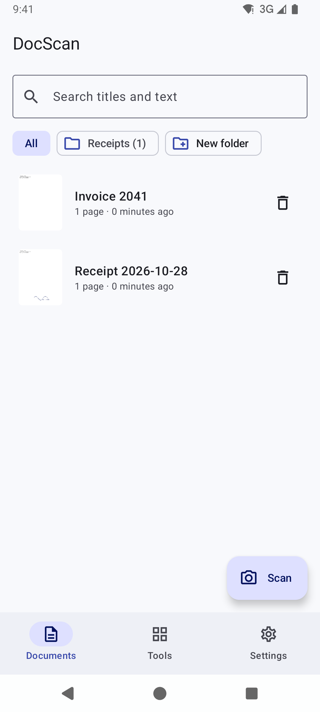<br><sub>Documents and folders</sub></td>
    <td align="center">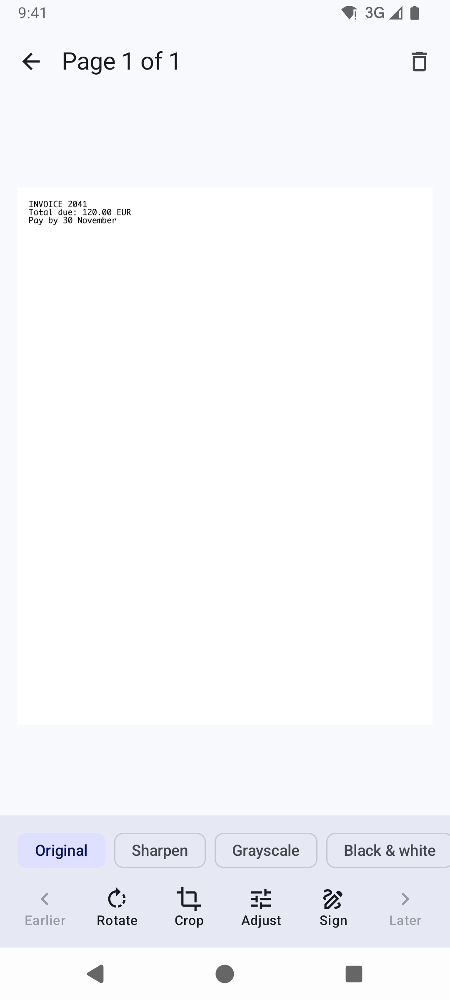<br><sub>Page tools</sub></td>
    <td align="center">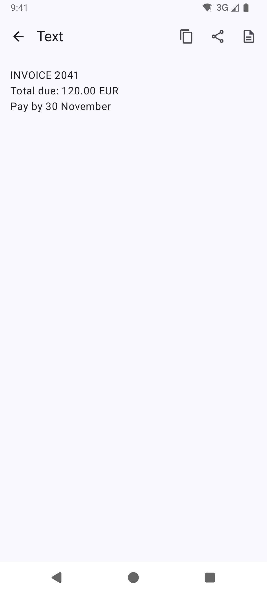<br><sub>Text recognition</sub></td>
    <td align="center">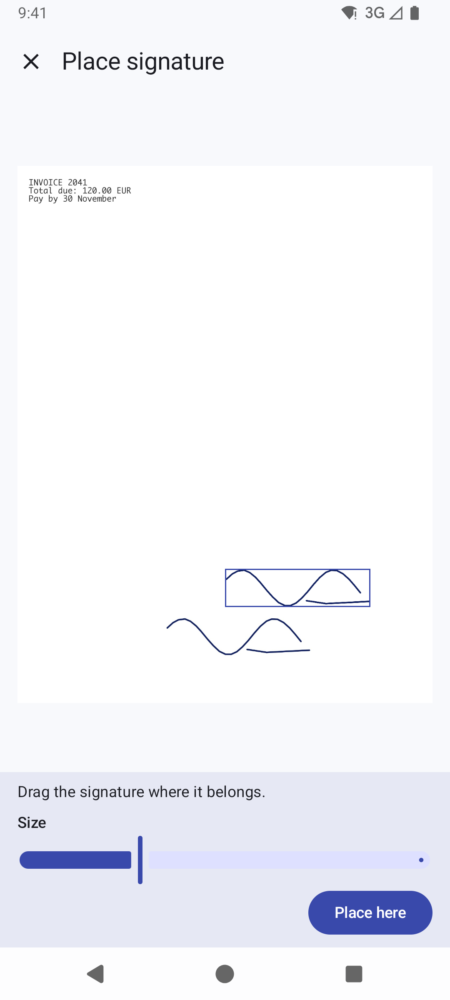<br><sub>Sign a page (Pro)</sub></td>
  </tr>
</table>

## Features

**Free**
- Scan one or many pages with automatic edge detection and perspective correction, or import from the gallery
- Filters (Original, Sharpen, Grayscale, Black & white, Brighten), brightness and contrast, rotate
- Re-crop any saved page by dragging its four corners
- Reorder pages by drag, add pages, delete pages
- Export as PDF (A4, US Letter or photo size; three quality levels) or as images, through the Android share sheet
- Extract text (OCR), copy it, share it, or save it as a `.txt` file
- Search documents by title **and** by the text inside them
- Folders, multi-select, merge several documents into one
- ID card mode (front and back on one page), PDF import, QR code reader
- Custom naming for new documents, "Delete all documents" in Settings

**Pro** (Google Play in-app purchase: monthly, yearly or lifetime)
- Draw and save signatures, then place them on any page
- Stamp your own watermark text on exported PDFs and images

## How it works

### For the user

1. **Scan.** Tap **Scan**. Google's ML Kit scanner opens the camera, finds the paper's edges, and lets you adjust the corners. Take as many pages as you need.
2. **Clean up.** The pages are saved as a new document with your default filter. Open any page to change the filter, rotate, re-crop, adjust brightness and contrast, or sign it.
3. **Organise.** Rename the document, drag pages into order, file it in a folder, or select several documents and combine them.
4. **Read.** Tap **Get text** to recognise the words on every page. After that, search finds the document by any word in it.
5. **Share.** Tap **Share as PDF** or **Share as images** and pick an app: email, Drive, WhatsApp, print, and so on.

<table>
  <tr>
    <td align="center">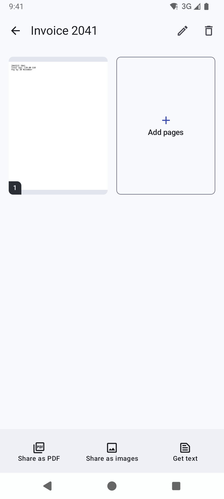<br><sub>Document</sub></td>
    <td align="center">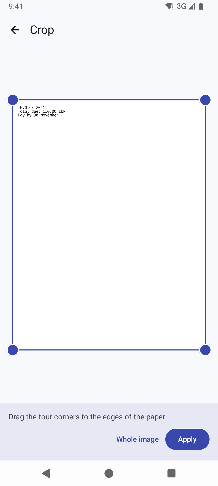<br><sub>Re-crop</sub></td>
    <td align="center">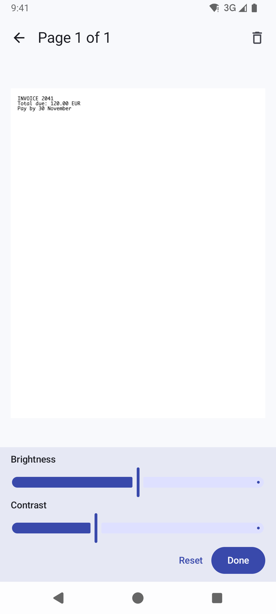<br><sub>Brightness and contrast</sub></td>
    <td align="center">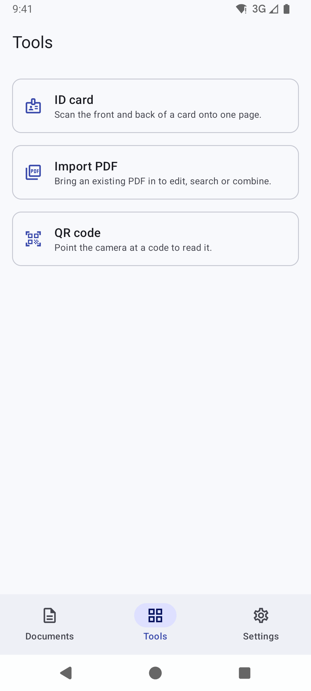<br><sub>Tools</sub></td>
  </tr>
  <tr>
    <td align="center">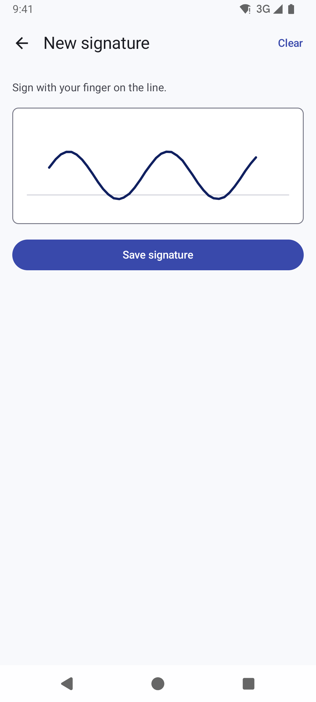<br><sub>Draw a signature (Pro)</sub></td>
    <td align="center">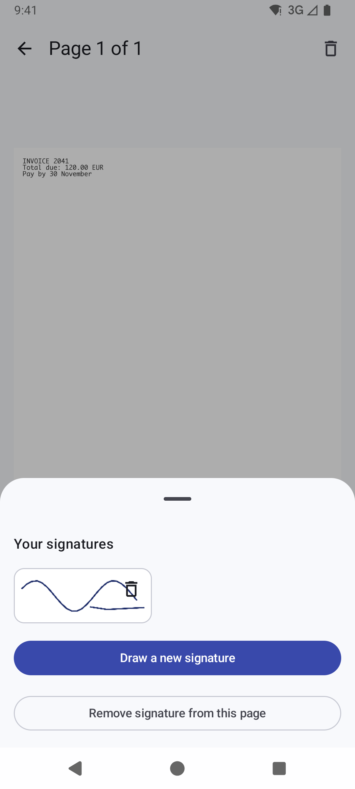<br><sub>Saved signatures (Pro)</sub></td>
    <td align="center">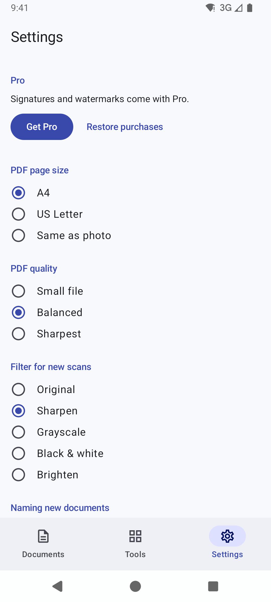<br><sub>Settings</sub></td>
    <td align="center">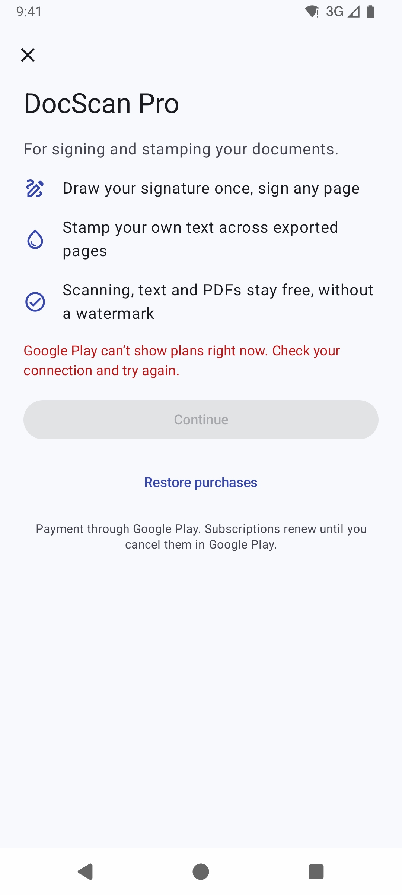<br><sub>Pro</sub></td>
  </tr>
</table>

### Under the hood

**Every edit is non-destructive.** Each page keeps its untouched original scan plus a list of adjustments:

```
original image ──► crop (4 corners) ──► rotate ──► filter + brightness/contrast ──► signature ──► page image
```

Changing any adjustment re-renders the page from the original, so quality never degrades and every change can be undone.
A watermark is not stored on the page; it is stamped only when you export.

| Step | How |
| --- | --- |
| Capture, edge detection, crop at scan time | [ML Kit Document Scanner](https://developers.google.com/ml-kit/vision/doc-scanner) (runs in Google Play services, so the app needs no camera permission) |
| Re-crop, filters, brightness/contrast, signature stamp | `android.graphics`: `Matrix.setPolyToPoly` for perspective, `ColorMatrix` for colour |
| Text recognition | [ML Kit Text Recognition v2](https://developers.google.com/ml-kit/vision/text-recognition/v2), on-device; results are cached on the page for search |
| PDF export | `android.graphics.pdf.PdfDocument` |
| PDF import | `android.graphics.pdf.PdfRenderer` (capped at 300 pages) |
| QR codes | ML Kit Code Scanner |
| Storage | Room (SQLite) for documents, pages and folders; image files in app-private storage |
| Pro | Google Play Billing 8 |

**Privacy.** Nothing is uploaded. Scans live in app-private storage, cloud backup and device-to-device transfer of scans are switched off (`data_extraction_rules.xml`), shared files go out only through per-share `FileProvider` grants, and Settings has **Delete all documents**.

## Architecture

Clean architecture in one module, layered by package. Dependencies point inward only.

```
ui/      Compose screens + ViewModels      ──► depends on domain
data/    Room, files, ML Kit, Play Billing ──► implements domain interfaces
domain/  models, repository interfaces, ports, use cases (pure Kotlin, no Android imports)
di/      AppContainer: the only place that names concrete classes
```

- **One use case per action** (`ImportScanUseCase`, `CropPageUseCase`, `PlaceSignatureUseCase`, …), each with an `invoke()` operator.
- **Small ports** (`ImageProcessor`, `PdfExporter`, `TextRecognizer`, `SignatureStore`, …) so an engine can be swapped by writing one class in `data/`.
- **Every screen is two composables:** a stateful `XxxRoute` that talks to the ViewModel, and a stateless `XxxScreen(state, actions)` with `@Preview`s for each state (loading, empty, filled, error, Pro, dark).
- **Navigation 3**: typed `@Serializable` `NavKey`s, one back stack, and a ViewModel store per entry.
- **Pro is enforced twice:** the UI sends free users to the paywall, and the use cases check entitlement again (`RequireProUseCase`).
- All user-visible text is in `res/values/strings.xml`; all versions are in `gradle/libs.versions.toml`.

## Tech stack

Kotlin 2.1 · Jetpack Compose (BOM 2025.11.01, Material 3) · Navigation 3 · Room 2.6 · Lifecycle 2.10 · ML Kit (document scanner, text recognition, code scanner) · Google Play Billing 8 · AGP 8.13 · minSdk 26, targetSdk 35, compileSdk 36

## Build and run

Requirements: JDK 17 or newer, Android SDK 36, and a device or emulator **with Google Play services** (the scanner and OCR run inside Play services).

```bash
./gradlew assembleDebug          # build
./gradlew installDebug           # install on a connected device
./gradlew testDebugUnitTest      # unit tests
./gradlew assembleRelease        # minified release build (R8), unsigned
```

On first use, Google Play services downloads the scanner and OCR models; this needs a network connection once.

### Setting up Pro (Google Play Billing)

Create these products in Play Console. The app looks them up by ID (`PlayBillingRepository`):

| Type | Product ID | Base plans |
| --- | --- | --- |
| Subscription | `docscan_pro` | `monthly`, `yearly` |
| One-time product | `docscan_pro_lifetime` | – |

Until the products exist, the paywall says plans are unavailable. To test real purchases, upload a build to an internal testing track and use a licence-tester account.
**Debug builds** have a *Pretend Pro is owned* switch in Settings, so Pro features can be tried without buying. Release builds ignore it.

## Project layout

```
app/src/main/java/com/docscan/app/
├── domain/      model/, repository/, service/ (ports), usecase/
├── data/        local/ (Room + migrations), repository/, service/ (Android + ML Kit), billing/
├── ui/          home/, document/, page/, crop/, signature/, ocr/, tools/, settings/, paywall/,
│                navigation/, components/, theme/, preview/
└── di/          AppContainer.kt
app/schemas/     exported Room schemas (one JSON per database version)
docs/screenshots/
```

## Known limitations

- One signature per page.
- The crop screen shows the page before rotation.
- Filters are global colour adjustments, not adaptive thresholding: strong shadows stay visible.
- Text recognition reads Latin-script languages.
- Purchases are verified on the device only; add server-side verification of purchase tokens before relying on Pro revenue at scale.
